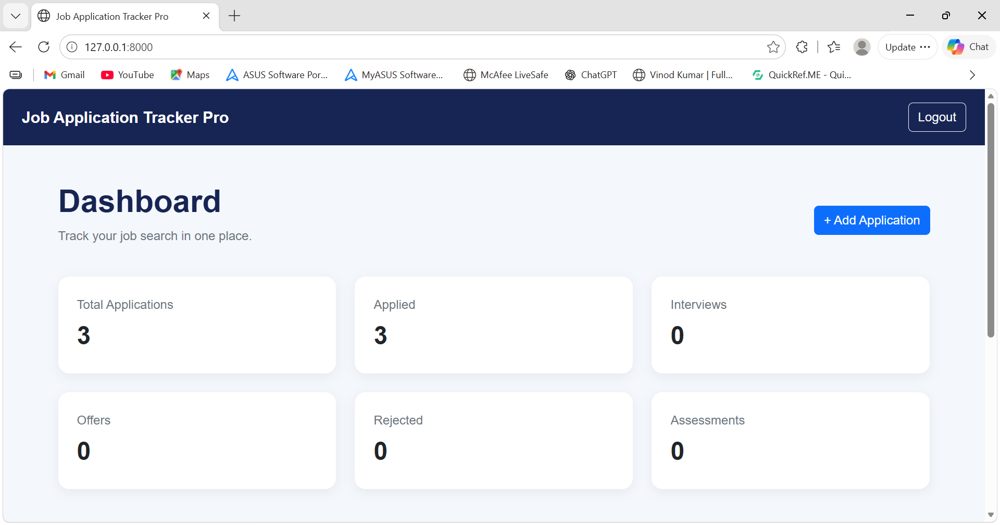
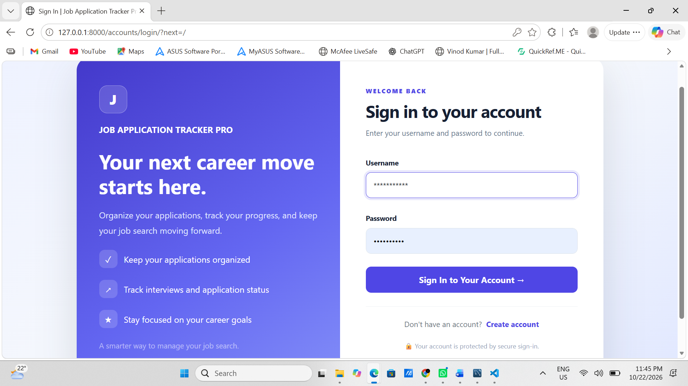
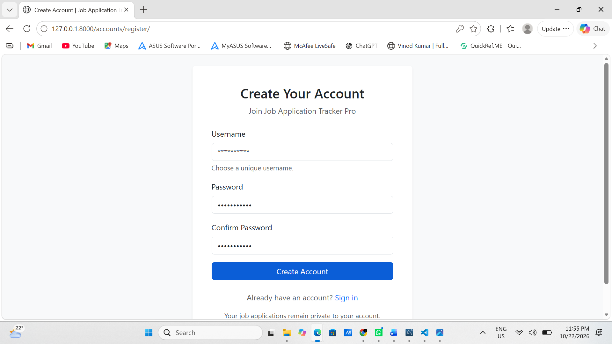

# Job Application Tracker Pro

A full-stack web application built with **Python, Django, MySQL, and Django REST Framework** to help job seekers organize applications, monitor recruitment progress, and manage their job search in one place.

## Features

- **Dashboard:** View job application statistics at a glance.
- **User Authentication:** Register, sign in, and sign out of your account.
- **Private Application Records:** Keep application records scoped to the authenticated user.
- **Application Management:** Create, view, edit, and delete job application records.
- **Application Details:** Store company names, job titles, job links, locations, application dates, salary details, and notes.
- **Search:** Find applications by company name, job title, or location.
- **Status Filtering:** Filter applications by recruitment status.
- **Status Tracking:** Track Applied, Assessment, Interview, Offer, Rejected, and Withdrawn statuses.
- **REST API:** Access application records through Django REST Framework with configured authentication and permissions.
- **Admin Panel:** Manage supported application data through Django's admin interface.
- **Automated Tests:** Verify application functionality with Django's test framework.

## Technology Stack

| Area | Technologies |
|---|---|
| Backend | Python, Django |
| API | Django REST Framework |
| Database | MySQL |
| Frontend | HTML, CSS, Bootstrap |
| Authentication | Django authentication system |
| Testing | Django Test Framework |
| Version Control | Git |

## Getting Started

### Prerequisites

- Python 3.12 or a compatible version
- MySQL Server
- Git

### 1. Clone the repository

Replace the placeholder with your GitHub repository URL after creating the repository.

```bash
git clone <your-github-repository-url>
cd JobApplicationTracker
```

### 2. Create and activate a virtual environment

```powershell
python -m venv venv
.\venv\Scripts\Activate.ps1
```

### 3. Install dependencies

```powershell
pip install -r requirements.txt
```

### 4. Configure environment variables

Create a `.env` file in the project root, alongside `manage.py`. Add your local MySQL settings:

```dotenv
DB_NAME=job_tracker_db
DB_USER=your_mysql_username
DB_PASSWORD=your_mysql_password
DB_HOST=127.0.0.1
DB_PORT=3307
```

Replace the example credentials and port with your actual local MySQL configuration. Make sure the database exists before continuing.

**Security:** Never commit `.env`, passwords, or database backups to GitHub. Keep these files private.

### 5. Apply database migrations

```bash
python manage.py migrate
```

### 6. Create an administrator account

```bash
python manage.py createsuperuser
```

Follow the prompts to configure your administrator account.

### 7. Start the development server

```bash
python manage.py runserver
```

Open the application in your browser:

- Application: http://127.0.0.1:8000/
- Login: http://127.0.0.1:8000/accounts/login/
- Registration: http://127.0.0.1:8000/accounts/register/
- Django admin: http://127.0.0.1:8000/admin/

## API Endpoints

| Method | Endpoint | Purpose |
|---|---|---|
| GET | `/api/applications/` | List accessible applications |
| POST | `/api/applications/` | Create an application |
| GET | `/api/applications/<id>/` | Retrieve an application |
| PUT / PATCH | `/api/applications/<id>/` | Update an application |
| DELETE | `/api/applications/<id>/` | Delete an application |

API access depends on the authentication and permission settings configured in the application. Application records are scoped according to the authenticated user's permissions.

## Running Tests

Run the application test suite:

```bash
python manage.py test
```

Run Django's configuration check:

```bash
python manage.py check
```

The current test suite has **9 passing tests** in the development environment.

## Project Structure

```text
JobApplicationTracker/
├── applications/
│   ├── migrations/
│   ├── templates/
│   ├── models.py
│   ├── serializers.py
│   ├── tests.py
│   ├── urls.py
│   └── views.py
├── config/
│   ├── settings.py
│   └── urls.py
├── templates/
│   └── registration/
├── manage.py
├── requirements.txt
└── README.md
```

## Future Improvements

- Pagination and additional dashboard analytics
- Expanded API and form validation tests
- Production deployment with secure settings
- Additional usability and accessibility enhancements

## Project Goal

This project demonstrates practical skills in Django web development, relational database integration, user authentication, CRUD operations, REST API development, search and filtering, and automated testing.


## 📸 Screenshots

### Dashboard


### Login Page


### Registration Page


